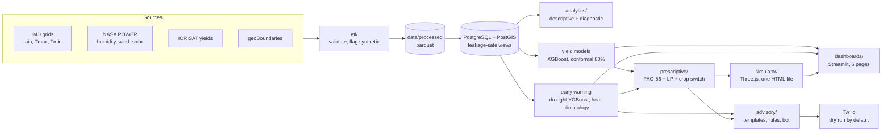

# ClimateResilience-India

Predictive analytics for extreme weather and crop-yield optimization in India, at **district level** (51 yield-reporting
units in Andhra Pradesh, Telangana, Karnataka and Tamil Nadu).

Ingest weather and yield data, store it in PostgreSQL/PostGIS, analyse climate risk, forecast yields, warn about
heatwaves and droughts, optimize irrigation, explore the season in a 3D simulator, and deliver advice through Streamlit
dashboards and a WhatsApp/SMS assistant.

> **Read the results honestly.** The yield models match, but do not clearly beat, simple baselines; the heatwave LSTM has no
> skill over climatology (so climatology is served); the drought model does beat climatology; the irrigation optimizer saves
> a lot of water in the model but keeps less yield than the 600 mm baseline; the satellite table is synthetic; the Hindi,
> Tamil and Telugu advisories are unreviewed drafts. The numbers below are generated from `reports/*.json`.

## Results

<!-- RESULTS:START -->
_Generated by `python scripts/make_report.py` from `reports/*.json`; do not edit by hand._

| Area | Measured result (held-out years) | What it means |
|---|---|---|
| Data | 51 district units, 633,369 daily weather rows, 4,286 yield records; satellite table 100% synthetic | all data-quality checks passed; satellite features are not used by the served models |
| Yield forecast (2015-17, 60-day lead) | relative RMSE 40.4% (pooled RMSE 1.04 t/ha, R² 0.91); best simple baseline (district trend) 40.9% | Level with the best baselines: ratio vs district trend 0.99 (95% interval 0.94 to 1.03); clearly better than last year's yield (0.81). 80% interval covers 80% of test cases |
| Drought warning (2020-24) | F1 0.50, PR-AUC 0.38 vs climatology 0.09 (base rate 7.5%) | Real skill over climatology and persistence (0.13); validation F1 was 0.70 |
| Heatwave warning (14 days) | LSTM PR-AUC 0.014 vs climatology 0.064 on 37 pooled onsets | No skill over climatology, so the **climatology** probability is served |
| Irrigation optimizer (normal rain) | saves 61% of the 600 mm baseline water; keeps 98% of baseline yield | Modelled, not field-tested. Vs an even split: 161 mm less water, yield difference +0.013 (interval +0.0005 to +0.0268), worse in 7 of 20 cases |
| Dashboards | 7 addresses, 0 failed browser checks, median warm page load 1.1-1.9 s | Headless Chromium with software rendering |
| Advisory bot | 7 of 7 smoke checks passed | Dry run by default; translations unreviewed |
| Tests | 355 automated tests | `make test`; in a clean Linux container: 327 passed, 9 skipped in 71.21s (0:01:11) |

<!-- RESULTS:END -->

The full write-up is `reports/final_report.md` (PDF: `reports/final_report.pdf`); decisions and their reasons are in
`docs/DECISIONS.md`; climate findings are in `docs/FINDINGS.md`.

## Architecture



## Quick start

**A. Run the app from the committed demo bundle.** Needs Python 3.11.

```bash
python -m venv .venv && .venv/bin/pip install -r requirements.txt     # Windows: .venv\Scripts\pip
python -m config.bundle restore        # copies data/sample/* into data/processed, models/, simulator/
make dashboards                        # http://localhost:8501   (Windows without make: mingw32-make)
```

**B. Docker.**

```bash
docker compose up --build app          # dashboards on http://localhost:8501 (starts the database too)
docker compose --profile bot up bot    # WhatsApp webhook on :8000 (needs TWILIO_AUTH_TOKEN, see advisory/README.md)
```

**C. Rebuild everything from the raw sources** (the first IMD download takes hours).

```bash
make setup && make db-up
make pipeline          # etl -> db-all -> analytics-eda -> train-yield -> train-extreme -> prescriptive-report -> export-sim -> embed-sim
python scripts/make_report.py
```

Windows without GNU make: use `mingw32-make` (same targets). Credentials (Earth Engine, Twilio) are optional and live
in `.env`, which is git-ignored (`.env.example` lists every variable).

## What is in the repository

| Phase | Folder / command | What it does |
|---|---|---|
| 1 ETL | `etl/`, `make etl` | Downloads and cleans weather, yields and boundaries; every row carries provenance; synthetic data is flagged `is_synthetic` |
| 2 Warehouse | `database/`, `make db-all` | PostGIS schema, loaders, materialized views with leakage-safe lead columns |
| 3 Analytics | `analytics/descriptive`, `analytics/diagnostic`, `make analytics-eda` | Rainfall variability, trends, drought/flood frequency, fixed-effects regression, climate clusters; `docs/FINDINGS.md` |
| 4 Yield | `analytics/predictive/`, `make train-yield` | Baselines, Ridge, RF, XGBoost, LSTM, conformal intervals, SHAP; `predict_yield()` |
| 5 Early warning | `make train-extreme` | Heatwave and drought probabilities with calibration; `risk_forecast()` |
| 6 Optimization | `analytics/prescriptive/`, `make prescriptive-report` | FAO-56 water balance, weekly irrigation LP, crop switch economics |
| 7 Simulator | `simulator/`, `make export-sim embed-sim test-sim` | Self-contained Three.js page driven by precomputed scenarios |
| 8 Dashboards | `dashboards/`, `make dashboards test-dashboards` | Six Streamlit pages; browser checks |
| 9 Advisory | `advisory/`, `make bot test-bot` | Templates in four languages, rules, Twilio wrapper (dry run), WhatsApp webhook, bulk composer |
| 10 Hardening | `Dockerfile`, `make pipeline`, `scripts/make_report.py` | Container, lock files, pre-commit, licences, report, demo script |

Shared conventions and the phase interfaces are in `CLAUDE.md`.

## Tests and checks

```bash
make test              # unit and integration tests (database tests skip when PostgreSQL is not up)
make lint              # ruff
make test-sim          # Three.js scene in headless Chromium            (needs: playwright install chromium)
make test-dashboards   # every dashboard page in a browser
make test-bot          # webhook over HTTP: signed, forged and unsigned requests
```

## Limits you should know

* **No live weather feed.** The early-warning pages and the bot replay observed history up to 2024-12-31.
* **Yields end in 2017**, so the latest honest hold-out is 2015-17 (heatwave/drought: 2020-24).
* **Districts are 1966 units**, not today's 114 districts and not villages.
* **Synthetic satellite table** (Earth Engine unauthenticated). Authenticate (`earthengine authenticate`, set `GEE_PROJECT`) and rerun
  `make etl` to replace it; the served models do not depend on it.
* **Unverified inputs:** crop parameters and prices (`config/crop_params.yaml`, `config/economics.yaml`), advisory wording and translations.
* **Licences for redistribution** of IMD-derived data and ODbL-derived polygons must be checked before publishing `data/sample/`
  (`scripts/check_licenses.md`).
* **Simulator frame rate** was measured only with software rendering; check it on your own GPU.

Deployment steps (Streamlit Community Cloud, Hugging Face Spaces, Docker) are in `docs/DEPLOY.md`; a five-minute demo
script that follows the measured results is `docs/DEMO_SCRIPT.md`.

## Data and software attribution

Rainfall and temperature: India Meteorological Department (IMD) gridded data. Humidity, wind and solar radiation: *These data were
obtained from the NASA Langley Research Center (LaRC) Prediction of Worldwide Energy Resource (POWER) Project funded through the
NASA Earth Science/Applied Science Program.* Crop yields: ICRISAT/TCI District Level Database for Indian Agriculture. District
boundaries: geoBoundaries (Runfola et al. 2020, *PLOS ONE* 15(4): e0231866), source Pathways Data Pvt. Ltd. / lgdirectory.gov.in,
ODbL 1.0. 3D engine: three.js (MIT). Dependency licences: `docs/DEPENDENCY_LICENSES.md`.
