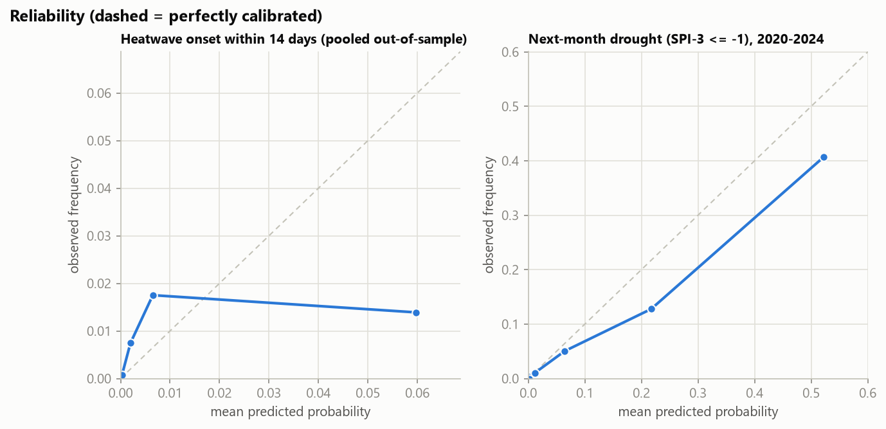
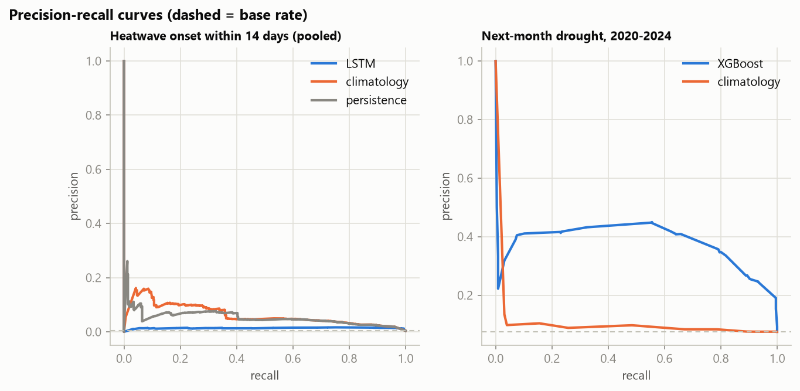

> Weather: real (IMD gridded rain, Tmax, Tmin; NASA POWER humidity, wind, solar).
> **Soil moisture and NDVI anomaly features are SYNTHETIC** (derived from rainfall; Google Earth Engine not authenticated). The shipped drought model therefore uses weather-derived features only.

# Extreme-weather early warning: heatwave and drought

Generated 2026-10-16T06:00:24+00:00 (seed 42, 158 s).

## Definitions and setup

- **Heatwave (IMD plains criterion)**: Tmax >= 40 C and >= 4.5 C above the district's daily normal for at least 2 consecutive days (severe: >= 6.5 C). Normals = district mean Tmax per calendar day over 1991-2014, smoothed with a circular 30-day mean. The plan asks for 1991-2020; the training years are used so that no label depends on the validation/test years (D-018).
- **Heatwave target**: an *onset* (first day of a heatwave spell) within the next 3, 7 or 14 days, forecast from the last 30 days of [Tmax, Tmin, rain, RH, wind, solar, sin/cos(doy)] with an LSTM; as-of days March-June only (all observed onsets are in May-June).
- **Drought target**: SPI-3 of the *next* month <= -1 (SPI from gamma fits per district and calendar month on 1991-2014, zeros handled with the mixed distribution), predicted by XGBoost from SPI-1/SPI-3 (and lags), rainfall deficit, Tmax anomaly and month.
- **Calibration**: isotonic regression on the validation years (or a 2-parameter logistic fit when there are fewer than 50 validation positives). Thresholds for precision/recall/F1 maximise F1 on the validation years.
- **Plan split**: train <= 2014, validation 2015-2019, test 2020-2024.

### Heatwave onsets per fold (why a single test window is not enough)

| name | plan_split | train | valid | test | train_onsets | valid_onsets | test_onsets |
| --- | --- | --- | --- | --- | --- | --- | --- |
| A | False | 1991-2001 | 2002-2004 | 2005-2009 | 45 | 26 | 7 |
| B | False | 1991-2006 | 2007-2009 | 2010-2014 | 77 | 1 | 15 |
| C | False | 1991-2011 | 2012-2014 | 2015-2019 | 78 | 15 | 12 |
| D | True | 1991-2014 | 2015-2019 | 2020-2024 | 93 | 12 | 3 |

**The plan's test window (2020-2024) contains only 3 heatwave onsets, so its metrics are anecdotal and no conclusion should be drawn from them.** Skill is therefore judged on the pooled out-of-sample predictions of all rolling-origin folds (37 onsets), each fold trained only on earlier years.

## Heatwave results

### Plan split (final fold)

| horizon_days | forecast | n | n_positive | base_rate | precision | recall | f1 | pr_auc | roc_auc | brier |
| --- | --- | --- | --- | --- | --- | --- | --- | --- | --- | --- |
| 3 | lstm | 31110 | 9 | 0.0003 | 0.0193 | 1.0000 | 0.0379 | 0.0189 | 0.9923 | 0.0003 |
| 3 | climatology | 31110 | 9 | 0.0003 | 0.0000 | 0.0000 | 0.0000 | 0.0065 | 0.9753 | 0.0003 |
| 3 | persistence | 31110 | 9 | 0.0003 | 0.0625 | 0.6667 | 0.1143 | 0.0418 | 0.8319 | 0.0030 |
| 7 | lstm | 31110 | 20 | 0.0006 | 0.0157 | 1.0000 | 0.0310 | 0.0330 | 0.9900 | 0.0006 |
| 7 | climatology | 31110 | 20 | 0.0006 | 0.0000 | 0.0000 | 0.0000 | 0.0139 | 0.9780 | 0.0007 |
| 7 | persistence | 31110 | 20 | 0.0006 | 0.1250 | 0.6000 | 0.2069 | 0.0753 | 0.7986 | 0.0030 |
| 14 | lstm | 31110 | 34 | 0.0011 | 0.0195 | 0.9706 | 0.0383 | 0.0194 | 0.9722 | 0.0011 |
| 14 | climatology | 31110 | 34 | 0.0011 | 0.0127 | 0.1176 | 0.0229 | 0.0191 | 0.9698 | 0.0014 |
| 14 | persistence | 31110 | 34 | 0.0011 | 0.1250 | 0.3529 | 0.1846 | 0.0448 | 0.6751 | 0.0034 |

### Pooled out-of-sample, all rolling-origin folds

| horizon_days | forecast | n | n_positive | base_rate | precision | recall | f1 | pr_auc | roc_auc | brier | brier_skill_vs_climatology |
| --- | --- | --- | --- | --- | --- | --- | --- | --- | --- | --- | --- |
| 3 | lstm | 124440 | 111 | 0.0009 | 0.0180 | 0.4324 | 0.0346 | 0.0070 | 0.8545 | 0.0010 | -0.0949 |
| 3 | climatology | 124440 | 111 | 0.0009 | 0.0167 | 0.2342 | 0.0311 | 0.0129 | 0.9227 | 0.0009 | 0.0000 |
| 3 | persistence | 124440 | 111 | 0.0009 | 0.0216 | 0.1532 | 0.0379 | 0.0041 | 0.5735 | 0.0069 | -6.7693 |
| 7 | lstm | 124440 | 258 | 0.0021 | 0.0252 | 0.4574 | 0.0477 | 0.0108 | 0.8818 | 0.0025 | -0.1995 |
| 7 | climatology | 124440 | 258 | 0.0021 | 0.0448 | 0.2171 | 0.0743 | 0.0331 | 0.9288 | 0.0021 | 0.0000 |
| 7 | persistence | 124440 | 258 | 0.0021 | 0.0407 | 0.1240 | 0.0612 | 0.0069 | 0.5590 | 0.0079 | -2.8007 |
| 14 | lstm | 124440 | 496 | 0.0040 | 0.0317 | 0.4536 | 0.0593 | 0.0142 | 0.8626 | 0.0045 | -0.1257 |
| 14 | climatology | 124440 | 496 | 0.0040 | 0.0980 | 0.2460 | 0.1401 | 0.0642 | 0.9296 | 0.0040 | 0.0000 |
| 14 | persistence | 124440 | 496 | 0.0040 | 0.0407 | 0.0645 | 0.0499 | 0.0064 | 0.5292 | 0.0098 | -1.4559 |

### Per-fold PR-AUC (LSTM / climatology / persistence)

| fold | horizon_days | climatology | lstm | persistence |
| --- | --- | --- | --- | --- |
| A | 3 | 0.0030 | 0.0012 | 0.0007 |
| A | 7 | 0.0065 | 0.0040 | 0.0016 |
| A | 14 | 0.0133 | 0.0070 | 0.0032 |
| B | 3 | 0.0329 | 0.0545 | 0.0080 |
| B | 7 | 0.0894 | 0.1022 | 0.0146 |
| B | 14 | 0.1648 | 0.0847 | 0.0121 |
| C | 3 | 0.0190 | 0.0095 | 0.0019 |
| C | 7 | 0.0435 | 0.0129 | 0.0032 |
| C | 14 | 0.0821 | 0.0208 | 0.0056 |
| D | 3 | 0.0065 | 0.0189 | 0.0418 |
| D | 7 | 0.0139 | 0.0330 | 0.0753 |
| D | 14 | 0.0191 | 0.0194 | 0.0448 |

### Is there skill, and at which lead time?

Block bootstrap (district-years) of the difference in PR-AUC against climatology, pooled out-of-sample:

- **3-day horizon**: LSTM PR-AUC 0.007 (95% CI 0.004-0.012), climatology 0.013, persistence 0.022; LSTM: WORSE than climatology: PR-AUC -0.006 (CI -0.018 to -0.000).
- **7-day horizon**: LSTM PR-AUC 0.011 (95% CI 0.006-0.017), climatology 0.033, persistence 0.043; LSTM: WORSE than climatology: PR-AUC -0.022 (CI -0.054 to -0.007).
- **14-day horizon**: LSTM PR-AUC 0.014 (95% CI 0.009-0.022), climatology 0.064, persistence 0.052; LSTM: WORSE than climatology: PR-AUC -0.050 (CI -0.101 to -0.018).

**No horizon shows demonstrated skill over climatology**, so no usable heatwave lead time can be claimed; the 14-day output must be read as a climatology-like probability.

**Served heatwave probability (`risk_forecast`): climatology.** LSTM shows no demonstrated PR-AUC skill over climatology at 14 days, so the climatological probability is served. The LSTM is still saved (`models/heatwave_lstm.pt`) for comparison and re-evaluation as more onsets accumulate.

## Drought results (plan split)

Base rate of next-month drought: train 0.158, validation 0.209, **test 0.075**. The test years are much wetter than the 1991-2014 reference, so probabilities calibrated on the validation years over-predict drought on the test years (see mean predicted vs observed below). Rows (train/valid/test): 14433/3009/3009.

| forecast | n | n_positive | base_rate | precision | recall | f1 | pr_auc | roc_auc | brier | brier_skill_vs_climatology | mean_predicted |
| --- | --- | --- | --- | --- | --- | --- | --- | --- | --- | --- | --- |
| XGBoost (weather) | 3009 | 225 | 0.0748 | 0.4091 | 0.6400 | 0.4991 | 0.3779 | 0.9188 | 0.0559 | 0.2741 | 0.1024 |
| XGBoost (weather+satellite) | 3009 | 225 | 0.0748 | 0.3911 | 0.6622 | 0.4917 | 0.3672 | 0.9152 | 0.0571 | 0.2587 | 0.1017 |
| climatology | 3009 | 225 | 0.0748 | 0.0883 | 0.2578 | 0.1315 | 0.0894 | 0.5601 | 0.0770 |  |  |
| persistence | 3009 | 225 | 0.0748 | 0.2696 | 0.2756 | 0.2725 | 0.1285 | 0.6076 | 0.1100 |  |  |

Block bootstrap (district-years) of PR-AUC on the test years:

- XGBoost (weather): 0.378; skill over climatology: PR-AUC +0.289 (CI +0.242 to +0.337).
- persistence: 0.162; skill over climatology: PR-AUC +0.072 (CI +0.046 to +0.106).

Shipped drought model: **XGBoost, weather features** (forced to weather-only because the satellite features are synthetic).

## Risk levels

`risk_forecast(district_id, as_of_date)` returns `heatwave_p` (14-day onset probability, 0 outside March-June), `drought_p` (next-month drought probability), the higher of the two hazard levels, and the lead time of the hazard that sets it (14 days for heatwave, 30 days for drought). Thresholds (settings.yaml `risk_levels`) apply to each hazard's calibrated probability and differ because base rates differ by an order of magnitude:

| hazard | moderate | high | severe |
| --- | --- | --- | --- |
| heatwave | 0.05 | 0.15 | 0.35 |
| drought | 0.30 | 0.50 | 0.70 |

Share of forecasts falling in each level:

| hazard | share_low | share_moderate | share_high | share_severe |
| --- | --- | --- | --- | --- |
| heatwave (14-day, in season, pooled folds) | 0.961 | 0.027 | 0.012 | 0.000 |
| drought (next month, test years) | 0.880 | 0.064 | 0.049 | 0.007 |

## Limitations

- **Rare events.** The IMD heatwave criterion applied to 1-degree district-mean data is met on ~0.06 percent of days (district means dilute station extremes); coastal criteria and station data are not used. Results describe district-mean heatwaves, not station heatwaves.
- **Few onsets.** Even pooled over rolling folds the number of onsets is small, confidence intervals are wide, and per-district claims are not possible.
- **Non-stationarity.** The reference period (1991-2014) is cooler and drier than 2020-2024; base rates change between splits, which hurts calibration. Operational use would need periodic recalibration.
- **Drought predictability is partly structural.** Next month's SPI-3 window shares two of its three months with the current SPI-3, so part of the skill is arithmetic persistence of observed rainfall; it is a one-month outlook, not a seasonal forecast, and the skill measured against persistence (above) is the more informative number.
- **Calibration on small samples.** With fewer than 50 validation positives a logistic calibrator replaces isotonic regression; probabilities are then smoother but less flexible.
- **Lead times** above are what the evaluation supports, not what the plan hoped for; the 14-day output is only as good as the horizon verdicts above.
- **Synthetic inputs** are flagged at the top; drought features from satellite are not used in the shipped model while they are synthetic.
