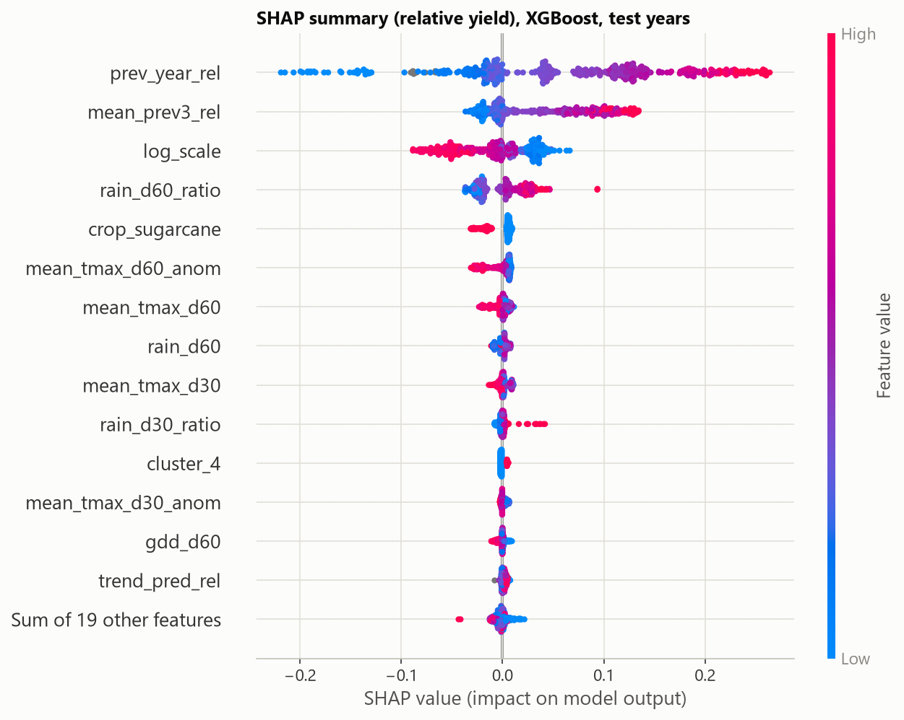
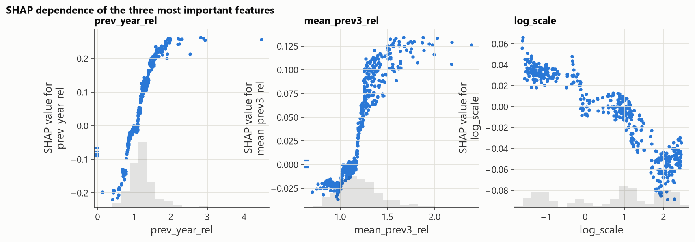

> Yield labels: real (ICRISAT District Level Database, 1991-2017), weather: IMD / NASA POWER (see docs/DATA_QUALITY.md).
> **Satellite features (NDVI, soil moisture) are SYNTHETIC** (Google Earth Engine not authenticated): they are derived from rainfall, so the `weather+satellite` rows below cannot show whether real satellite data would help.

# Yield model comparison

Generated 2026-10-16T07:26:20+00:00 (commit `27a069f`, seed 42, data from postgres, 40 Optuna trials, 205 s).

## Setup

- **Unit**: district x crop x season x crop year; target `y_rel` = yield / mean of the same district-crop's earlier yields (scale-free so crops pool); reported errors are converted back to t/ha.
- **Time split** (never random): train crop years 2000-2011, validation 2012-2014 (tuning, early stopping, conformal calibration), test 2015-2017 (touched once, here). The plan's 2018 / 2019-21 / 2022-24 split is not possible because real yields end in 2017 (D-006).
- **Forecast leads**: 30, 60 and 90 days after the season starts. Features use only season days before the lead, satellite composites that had finished by then, and yields of earlier years (leakage test in `tests/test_predictive.py`).
- **Baselines** (no weather, earlier years only): naive last-year yield (required by the plan), a district linear trend, and the mean of the previous three years. The 3-year-mean baseline was added after the first evaluation round, when the first test numbers had already been seen; adding a stronger baseline can only make the comparison more conservative.
- **Feature sets**: `weather` (season-to-date weather and anomalies, history, crop/season/cluster one-hots) and `weather+satellite` (adds NDVI / soil moisture).

Rows per dataset (train / valid / test): weather|30: 1904 / 468 / 457; weather|60: 1904 / 468 / 457; weather|90: 1904 / 468 / 457

## Headline

- XGBoost (weather, lead 60 d) vs **district linear trend** on the test years: not distinguishable (ratio 0.987, CI 0.936-1.033 includes 1).
- XGBoost (weather, lead 60 d) vs **naive (last year)** on the test years: better (18.5% lower relative RMSE; CI 0.773-0.864 excludes 1).
- XGBoost (weather, lead 60 d) vs **mean of previous 3 years** on the test years: not distinguishable (ratio 0.958, CI 0.917-1.001 includes 1).
- Best learned model on the validation years (weather, lead 60 d): **LSTM**.

Relative RMSE at this lead, validation vs test years (a large gap means validation results do not carry over):

| model | valid_rmse_rel | test_rmse_rel |
| --- | --- | --- |
| naive (last year) | 0.385 | 0.496 |
| district linear trend | 0.399 | 0.409 |
| mean of previous 3 years | 0.365 | 0.421 |
| ridge | 0.354 | 0.415 |
| random forest | 0.358 | 0.408 |
| XGBoost (temperature-monotone) | 0.357 | 0.404 |
| XGBoost (unconstrained) | 0.351 | 0.403 |
| LSTM | 0.343 | 0.428 |

## Test-set results, all crops pooled

`rmse_rel` is comparable across crops; `rmse`/`mae` are in t/ha and dominated by sugarcane.

### Feature set: weather

| lead_days | model | n | rmse_rel | rmse | mae | r2 | mape |
| --- | --- | --- | --- | --- | --- | --- | --- |
| 30 | naive (last year) | 457 | 0.496 | 1.184 | 0.673 | 0.882 | 30.382 |
| 30 | district linear trend | 457 | 0.409 | 1.271 | 0.743 | 0.864 | 25.927 |
| 30 | mean of previous 3 years | 457 | 0.421 | 0.965 | 0.586 | 0.921 | 27.189 |
| 30 | ridge | 457 | 0.411 | 1.019 | 0.608 | 0.912 | 25.263 |
| 30 | random forest | 457 | 0.401 | 1.037 | 0.600 | 0.909 | 25.389 |
| 30 | XGBoost (temperature-monotone) | 457 | 0.405 | 1.032 | 0.611 | 0.910 | 25.081 |
| 30 | XGBoost (unconstrained) | 457 | 0.400 | 1.011 | 0.599 | 0.914 | 24.933 |
| 30 | LSTM | 457 | 0.426 | 1.088 | 0.628 | 0.900 | 27.080 |
| 60 | naive (last year) | 457 | 0.496 | 1.184 | 0.673 | 0.882 | 30.382 |
| 60 | district linear trend | 457 | 0.409 | 1.271 | 0.743 | 0.864 | 25.927 |
| 60 | mean of previous 3 years | 457 | 0.421 | 0.965 | 0.586 | 0.921 | 27.189 |
| 60 | ridge | 457 | 0.415 | 1.071 | 0.636 | 0.903 | 25.301 |
| 60 | random forest | 457 | 0.408 | 1.064 | 0.611 | 0.904 | 25.332 |
| 60 | XGBoost (temperature-monotone) | 457 | 0.404 | 1.042 | 0.618 | 0.909 | 24.683 |
| 60 | XGBoost (unconstrained) | 457 | 0.403 | 1.010 | 0.598 | 0.914 | 25.088 |
| 60 | LSTM | 457 | 0.428 | 1.090 | 0.636 | 0.900 | 27.182 |
| 90 | naive (last year) | 457 | 0.496 | 1.184 | 0.673 | 0.882 | 30.382 |
| 90 | district linear trend | 457 | 0.409 | 1.271 | 0.743 | 0.864 | 25.927 |
| 90 | mean of previous 3 years | 457 | 0.421 | 0.965 | 0.586 | 0.921 | 27.189 |
| 90 | ridge | 457 | 0.425 | 1.112 | 0.650 | 0.896 | 26.690 |
| 90 | random forest | 457 | 0.407 | 1.084 | 0.622 | 0.901 | 25.189 |
| 90 | XGBoost (temperature-monotone) | 457 | 0.405 | 1.073 | 0.630 | 0.903 | 24.773 |
| 90 | XGBoost (unconstrained) | 457 | 0.404 | 1.015 | 0.598 | 0.913 | 24.522 |
| 90 | LSTM | 457 | 0.430 | 1.109 | 0.648 | 0.896 | 27.153 |

### Feature set: weather+satellite

| lead_days | model | n | rmse_rel | rmse | mae | r2 | mape |
| --- | --- | --- | --- | --- | --- | --- | --- |
| 30 | naive (last year) | 457 | 0.496 | 1.184 | 0.673 | 0.882 | 30.382 |
| 30 | district linear trend | 457 | 0.409 | 1.271 | 0.743 | 0.864 | 25.927 |
| 30 | mean of previous 3 years | 457 | 0.421 | 0.965 | 0.586 | 0.921 | 27.189 |
| 30 | ridge | 457 | 0.406 | 1.016 | 0.613 | 0.913 | 24.746 |
| 30 | random forest | 457 | 0.407 | 1.031 | 0.595 | 0.910 | 25.449 |
| 30 | XGBoost (temperature-monotone) | 457 | 0.403 | 0.989 | 0.577 | 0.918 | 24.379 |
| 30 | XGBoost (unconstrained) | 457 | 0.407 | 1.033 | 0.612 | 0.910 | 24.947 |
| 30 | LSTM | 457 | 0.437 | 1.093 | 0.641 | 0.899 | 27.926 |
| 60 | naive (last year) | 457 | 0.496 | 1.184 | 0.673 | 0.882 | 30.382 |
| 60 | district linear trend | 457 | 0.409 | 1.271 | 0.743 | 0.864 | 25.927 |
| 60 | mean of previous 3 years | 457 | 0.421 | 0.965 | 0.586 | 0.921 | 27.189 |
| 60 | ridge | 457 | 0.417 | 1.081 | 0.646 | 0.901 | 25.371 |
| 60 | random forest | 457 | 0.406 | 1.032 | 0.597 | 0.910 | 25.031 |
| 60 | XGBoost (temperature-monotone) | 457 | 0.404 | 1.032 | 0.613 | 0.910 | 24.605 |
| 60 | XGBoost (unconstrained) | 457 | 0.407 | 1.013 | 0.603 | 0.914 | 24.925 |
| 60 | LSTM | 457 | 0.434 | 1.081 | 0.632 | 0.901 | 27.371 |
| 90 | naive (last year) | 457 | 0.496 | 1.184 | 0.673 | 0.882 | 30.382 |
| 90 | district linear trend | 457 | 0.409 | 1.271 | 0.743 | 0.864 | 25.927 |
| 90 | mean of previous 3 years | 457 | 0.421 | 0.965 | 0.586 | 0.921 | 27.189 |
| 90 | ridge | 457 | 0.417 | 1.073 | 0.641 | 0.903 | 25.361 |
| 90 | random forest | 457 | 0.406 | 1.047 | 0.608 | 0.908 | 24.921 |
| 90 | XGBoost (temperature-monotone) | 457 | 0.404 | 1.012 | 0.600 | 0.914 | 24.596 |
| 90 | XGBoost (unconstrained) | 457 | 0.404 | 1.023 | 0.606 | 0.912 | 24.599 |
| 90 | LSTM | 457 | 0.434 | 1.103 | 0.641 | 0.898 | 27.528 |

## Test-set results by crop (weather, lead 60 d)

| crop | model | n | rmse | mae | r2 | mape | rmse_rel |
| --- | --- | --- | --- | --- | --- | --- | --- |
| cotton | naive (last year) | 122 | 0.176 | 0.135 | -0.013 | 40.254 | 0.584 |
| cotton | district linear trend | 122 | 0.148 | 0.118 | 0.279 | 35.610 | 0.489 |
| cotton | mean of previous 3 years | 122 | 0.160 | 0.126 | 0.159 | 40.772 | 0.529 |
| cotton | ridge | 122 | 0.149 | 0.114 | 0.272 | 34.274 | 0.498 |
| cotton | random forest | 122 | 0.148 | 0.113 | 0.286 | 35.372 | 0.500 |
| cotton | XGBoost (temperature-monotone) | 122 | 0.148 | 0.115 | 0.280 | 34.498 | 0.499 |
| cotton | XGBoost (unconstrained) | 122 | 0.150 | 0.117 | 0.259 | 35.267 | 0.499 |
| cotton | LSTM | 122 | 0.154 | 0.118 | 0.220 | 37.439 | 0.514 |
| rice | naive (last year) | 153 | 0.566 | 0.432 | 0.581 | 16.761 | 0.256 |
| rice | district linear trend | 153 | 0.444 | 0.354 | 0.741 | 13.324 | 0.202 |
| rice | mean of previous 3 years | 153 | 0.500 | 0.377 | 0.672 | 14.629 | 0.224 |
| rice | ridge | 153 | 0.450 | 0.352 | 0.735 | 13.322 | 0.205 |
| rice | random forest | 153 | 0.451 | 0.349 | 0.733 | 13.474 | 0.201 |
| rice | XGBoost (temperature-monotone) | 153 | 0.454 | 0.355 | 0.731 | 13.456 | 0.203 |
| rice | XGBoost (unconstrained) | 153 | 0.466 | 0.364 | 0.716 | 13.878 | 0.209 |
| rice | LSTM | 153 | 0.477 | 0.365 | 0.702 | 14.493 | 0.214 |
| sugarcane | naive (last year) | 138 | 2.003 | 1.445 | -0.098 | 19.438 | 0.255 |
| sugarcane | district linear trend | 138 | 2.233 | 1.842 | -0.365 | 22.930 | 0.311 |
| sugarcane | mean of previous 3 years | 138 | 1.625 | 1.266 | 0.277 | 17.208 | 0.212 |
| sugarcane | ridge | 138 | 1.844 | 1.468 | 0.069 | 18.767 | 0.244 |
| sugarcane | random forest | 138 | 1.833 | 1.390 | 0.080 | 17.906 | 0.237 |
| sugarcane | XGBoost (temperature-monotone) | 138 | 1.791 | 1.414 | 0.122 | 18.171 | 0.237 |
| sugarcane | XGBoost (unconstrained) | 138 | 1.726 | 1.335 | 0.185 | 17.548 | 0.227 |
| sugarcane | LSTM | 138 | 1.870 | 1.445 | 0.043 | 18.644 | 0.251 |
| wheat | naive (last year) | 44 | 0.879 | 0.587 | -0.786 | 84.702 | 1.084 |
| wheat | district linear trend | 44 | 0.619 | 0.387 | 0.114 | 52.298 | 0.793 |
| wheat | mean of previous 3 years | 44 | 0.671 | 0.456 | -0.042 | 64.506 | 0.867 |
| wheat | ridge | 44 | 0.697 | 0.465 | -0.123 | 62.564 | 0.877 |
| wheat | random forest | 44 | 0.675 | 0.451 | -0.053 | 62.021 | 0.848 |
| wheat | XGBoost (temperature-monotone) | 44 | 0.658 | 0.431 | -0.002 | 56.935 | 0.829 |
| wheat | XGBoost (unconstrained) | 44 | 0.656 | 0.433 | 0.004 | 59.496 | 0.826 |
| wheat | LSTM | 44 | 0.714 | 0.472 | -0.180 | 69.648 | 0.902 |

## Does the satellite feature set help?

Test `rmse_rel`; negative change = satellite helps. **Satellite data is synthetic, so this is not evidence about real NDVI.**

| lead_days | model | weather | weather+satellite | change_with_satellite |
| --- | --- | --- | --- | --- |
| 30 | naive (last year) | 0.496 | 0.496 | 0.000 |
| 30 | district linear trend | 0.409 | 0.409 | 0.000 |
| 30 | mean of previous 3 years | 0.421 | 0.421 | 0.000 |
| 30 | ridge | 0.411 | 0.406 | -0.006 |
| 30 | random forest | 0.401 | 0.407 | 0.006 |
| 30 | XGBoost (temperature-monotone) | 0.405 | 0.403 | -0.001 |
| 30 | XGBoost (unconstrained) | 0.400 | 0.407 | 0.007 |
| 30 | LSTM | 0.426 | 0.437 | 0.011 |
| 60 | naive (last year) | 0.496 | 0.496 | 0.000 |
| 60 | district linear trend | 0.409 | 0.409 | 0.000 |
| 60 | mean of previous 3 years | 0.421 | 0.421 | 0.000 |
| 60 | ridge | 0.415 | 0.417 | 0.002 |
| 60 | random forest | 0.408 | 0.406 | -0.002 |
| 60 | XGBoost (temperature-monotone) | 0.404 | 0.404 | -0.000 |
| 60 | XGBoost (unconstrained) | 0.403 | 0.407 | 0.004 |
| 60 | LSTM | 0.428 | 0.434 | 0.006 |
| 90 | naive (last year) | 0.496 | 0.496 | 0.000 |
| 90 | district linear trend | 0.409 | 0.409 | 0.000 |
| 90 | mean of previous 3 years | 0.421 | 0.421 | 0.000 |
| 90 | ridge | 0.425 | 0.417 | -0.009 |
| 90 | random forest | 0.407 | 0.406 | -0.001 |
| 90 | XGBoost (temperature-monotone) | 0.405 | 0.404 | -0.000 |
| 90 | XGBoost (unconstrained) | 0.404 | 0.404 | -0.000 |
| 90 | LSTM | 0.430 | 0.434 | 0.004 |

## Paired cluster bootstrap against the baselines (test years)

Ratio of relative RMSE (model / baseline), 2000 resamples of districts; < 1 means the model is better.

| lead_days | model | baseline | selected_on_validation | ratio | lo | hi | p_not_better | verdict |
| --- | --- | --- | --- | --- | --- | --- | --- | --- |
| 30 | LSTM | district linear trend | True | 1.040 | 0.982 | 1.091 | 0.924 | not distinguishable (ratio 1.040, CI 0.982-1.091 includes 1) |
| 30 | LSTM | naive (last year) | True | 0.859 | 0.829 | 0.893 | 0.000 | better (14.1% lower relative RMSE; CI 0.829-0.893 excludes 1) |
| 30 | LSTM | mean of previous 3 years | True | 1.010 | 0.974 | 1.050 | 0.698 | not distinguishable (ratio 1.010, CI 0.974-1.050 includes 1) |
| 30 | XGBoost (temperature-monotone) | district linear trend | False | 0.989 | 0.942 | 1.032 | 0.301 | not distinguishable (ratio 0.989, CI 0.942-1.032 includes 1) |
| 30 | XGBoost (temperature-monotone) | naive (last year) | False | 0.816 | 0.773 | 0.865 | 0.000 | better (18.4% lower relative RMSE; CI 0.773-0.865 excludes 1) |
| 30 | XGBoost (temperature-monotone) | mean of previous 3 years | False | 0.960 | 0.922 | 0.998 | 0.021 | better (4.0% lower relative RMSE; CI 0.922-0.998 excludes 1) |
| 60 | LSTM | district linear trend | True | 1.046 | 0.988 | 1.094 | 0.940 | not distinguishable (ratio 1.046, CI 0.988-1.094 includes 1) |
| 60 | LSTM | naive (last year) | True | 0.864 | 0.838 | 0.892 | 0.000 | better (13.6% lower relative RMSE; CI 0.838-0.892 excludes 1) |
| 60 | LSTM | mean of previous 3 years | True | 1.016 | 0.983 | 1.052 | 0.823 | not distinguishable (ratio 1.016, CI 0.983-1.052 includes 1) |
| 60 | XGBoost (temperature-monotone) | district linear trend | False | 0.987 | 0.936 | 1.033 | 0.294 | not distinguishable (ratio 0.987, CI 0.936-1.033 includes 1) |
| 60 | XGBoost (temperature-monotone) | naive (last year) | False | 0.815 | 0.773 | 0.864 | 0.000 | better (18.5% lower relative RMSE; CI 0.773-0.864 excludes 1) |
| 60 | XGBoost (temperature-monotone) | mean of previous 3 years | False | 0.958 | 0.917 | 1.001 | 0.025 | not distinguishable (ratio 0.958, CI 0.917-1.001 includes 1) |
| 90 | LSTM | district linear trend | True | 1.050 | 0.996 | 1.097 | 0.964 | not distinguishable (ratio 1.050, CI 0.996-1.097 includes 1) |
| 90 | LSTM | naive (last year) | True | 0.867 | 0.840 | 0.897 | 0.000 | better (13.3% lower relative RMSE; CI 0.840-0.897 excludes 1) |
| 90 | LSTM | mean of previous 3 years | True | 1.020 | 0.987 | 1.058 | 0.877 | not distinguishable (ratio 1.020, CI 0.987-1.058 includes 1) |
| 90 | XGBoost (temperature-monotone) | district linear trend | False | 0.989 | 0.941 | 1.039 | 0.334 | not distinguishable (ratio 0.989, CI 0.941-1.039 includes 1) |
| 90 | XGBoost (temperature-monotone) | naive (last year) | False | 0.816 | 0.778 | 0.864 | 0.000 | better (18.4% lower relative RMSE; CI 0.778-0.864 excludes 1) |
| 90 | XGBoost (temperature-monotone) | mean of previous 3 years | False | 0.960 | 0.919 | 1.009 | 0.064 | not distinguishable (ratio 0.960, CI 0.919-1.009 includes 1) |

## Spatial generalisation: leave-one-state-out (XGBoost, weather, lead 60 d)

Trained on the other states' rows up to the end of validation, tested on the held-out state's test years.

| held_out_state | n_test | xgb_rmse_rel | naive_rmse_rel | xgb_mae | naive_mae | xgb_vs_naive |
| --- | --- | --- | --- | --- | --- | --- |
| Andhra Pradesh | 105 | 0.350 | 0.435 | 0.538 | 0.408 | 0.805 |
| Karnataka | 177 | 0.400 | 0.505 | 0.577 | 0.676 | 0.792 |
| Tamil Nadu | 84 | 0.313 | 0.380 | 0.694 | 0.893 | 0.823 |
| Telangana | 91 | 0.510 | 0.621 | 0.601 | 0.771 | 0.822 |

## 80 percent prediction intervals (conformalized quantile regression, weather)

Calibrated on the validation years; empirical coverage on the test years (target 80%).

| lead_days | n | coverage | mean_width_rel | coverage_valid_calibration | conformal_qhat_rel |
| --- | --- | --- | --- | --- | --- |
| 30 | 457 | 0.781 | 0.754 | 0.803 | 0.035 |
| 60 | 457 | 0.803 | 0.741 | 0.806 | 0.048 |
| 90 | 457 | 0.796 | 0.740 | 0.806 | 0.065 |

## What-if behaviour of the served model (validation years, lead 60 d)

Mean percentage change of the forecast when the season's daily weather is rescaled (`predict_yield` overrides), over every district-crop-year of the validation period. Temperature features are constrained to be non-increasing (D-014) because the unconstrained model predicted yield *gains* from large warming (extrapolation artefact of trees).

| scenario | all | cotton | rice | share_of_cases_with_higher_forecast |
| --- | --- | --- | --- | --- |
| rain x0.6 | -2.22 | -2.27 | -2.58 | 0.10 |
| rain x0.8 | -1.18 | -1.22 | -1.35 | 0.11 |
| rain x1.2 | 0.96 | 1.15 | 1.05 | 0.79 |
| rain x1.4 | 1.69 | 1.90 | 1.75 | 0.83 |
| -2 C | 1.87 | 2.36 | 1.71 | 0.93 |
| +1 C | -1.60 | -1.68 | -1.57 | 0.00 |
| +2 C | -2.30 | -2.55 | -2.26 | 0.00 |
| +4 C | -3.52 | -3.97 | -3.17 | 0.00 |

For comparison, the Phase 3 district-FE regression gives -0.147 t/ha per +1 C for rice (p = 2.77e-09). The served model's average response for rice is -0.046 t/ha per +1 C, i.e. it understates the regression sensitivity (a conservative what-if).

## Explanation (SHAP)





Top features by mean |SHAP| (relative-yield units):

| feature | mean_abs_shap |
| --- | --- |
| prev_year_rel | 0.101 |
| mean_prev3_rel | 0.049 |
| log_scale | 0.031 |
| rain_d60_ratio | 0.020 |
| crop_sugarcane | 0.010 |
| mean_tmax_d60_anom | 0.009 |
| mean_tmax_d60 | 0.005 |
| rain_d60 | 0.003 |
| mean_tmax_d30 | 0.003 |
| rain_d30_ratio | 0.002 |

## Tuned hyperparameters

```json
{
 "xgboost": {
  "30": {
   "max_depth": 3,
   "learning_rate": 0.19564156449038717,
   "subsample": 0.6154296246277002,
   "colsample_bytree": 0.725956564659385,
   "min_child_weight": 7,
   "reg_lambda": 18.77216490338487,
   "gamma": 0.022077083992207355,
   "n_estimators": 14
  },
  "60": {
   "max_depth": 3,
   "learning_rate": 0.01252616265429781,
   "subsample": 0.7873382137341236,
   "colsample_bytree": 0.5839769701526194,
   "min_child_weight": 5,
   "reg_lambda": 15.173194256168978,
   "gamma": 0.04274959459983576,
   "n_estimators": 234
  },
  "90": {
   "max_depth": 3,
   "learning_rate": 0.09647413670634838,
   "subsample": 0.8844942727149475,
   "colsample_bytree": 0.7971881718397023,
   "min_child_weight": 2,
   "reg_lambda": 0.5304889167177631,
   "gamma": 0.007268877623690098,
   "n_estimators": 39
  }
 },
 "random_forest": {
  "30": {
   "min_samples_leaf": 10,
   "max_features": 0.3
  },
  "60": {
   "min_samples_leaf": 10,
   "max_features": 0.6
  },
  "90": {
   "min_samples_leaf": 10,
   "max_features": 0.6
  }
 },
 "ridge_alpha": {
  "weather|30": 316.22776601683796,
  "weather|60": 316.22776601683796,
  "weather|90": 0.01,
  "weather+satellite|30": 1000.0,
  "weather+satellite|60": 316.22776601683796,
  "weather+satellite|90": 316.22776601683796
 },
 "lstm_epochs": {
  "weather|30": 56,
  "weather|60": 39,
  "weather|90": 39,
  "weather+satellite|30": 39,
  "weather+satellite|60": 39,
  "weather+satellite|90": 39
 }
}
```

## Limitations

- **District aggregates, not fields.** Predictions are district-level averages; they do not describe individual farms (ecological fallacy). District units are reconstructed (D-006).
- **Three test years.** The test period 2015-2017 is short; the bootstrap intervals above reflect resampling districts, not additional years, so they understate year-to-year uncertainty. Models that look better on the validation years than on the test years should be read with that in mind.
- **Weather explains little beyond history.** Phase 3 found that weather adds only a small share of variance beyond district and year effects (see docs/FINDINGS.md), so models gain mostly from yield history. Skill claims must be read against the district-trend baseline.
- **Satellite features** are synthetic until Earth Engine is authenticated; serving models therefore use weather only (D-013).
- **Interventions are not modelled.** Irrigation, varieties and prices drive yields but are not features; what-if answers describe weather sensitivity under the fitted statistical relationship, not agronomic causation.
- **Season attribution and sugarcane units** (D-007) limit comparisons across crops.
- Shipped models are fitted on train years only (the ones evaluated here), not refit on validation or test years.
